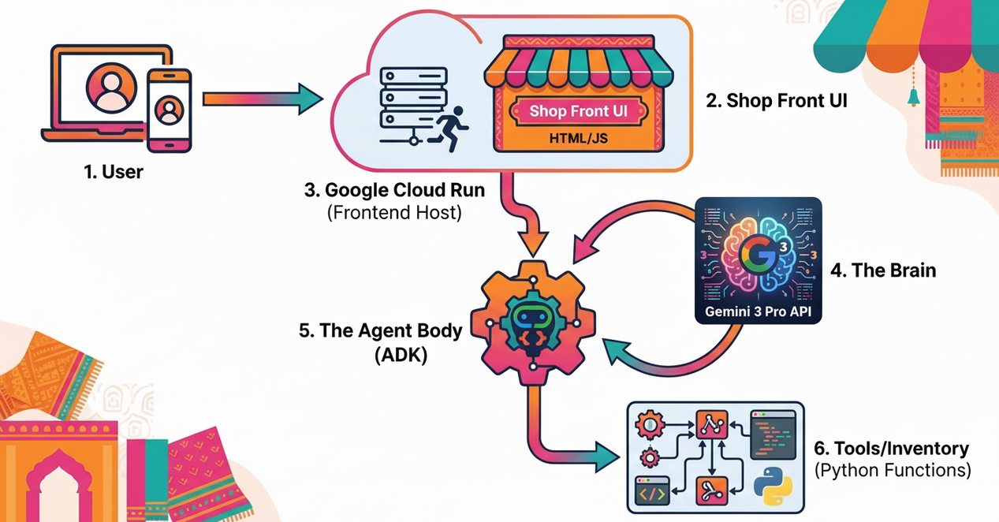
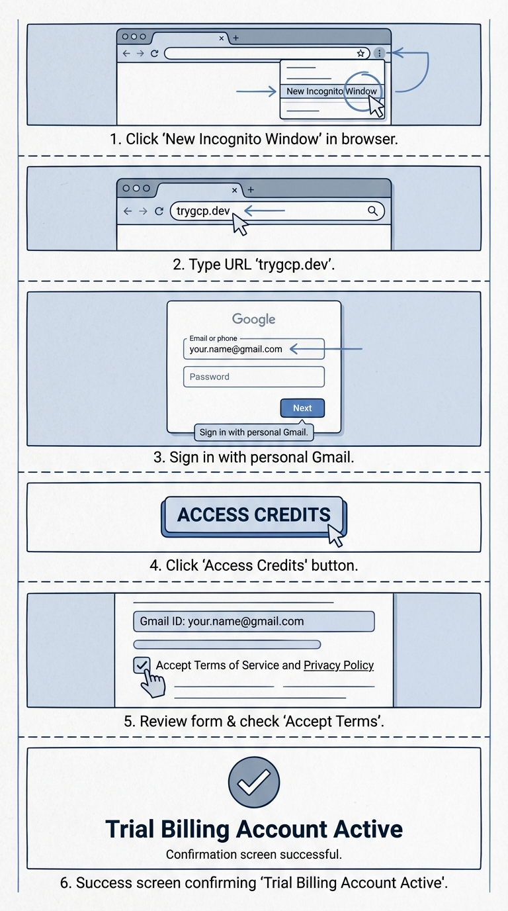
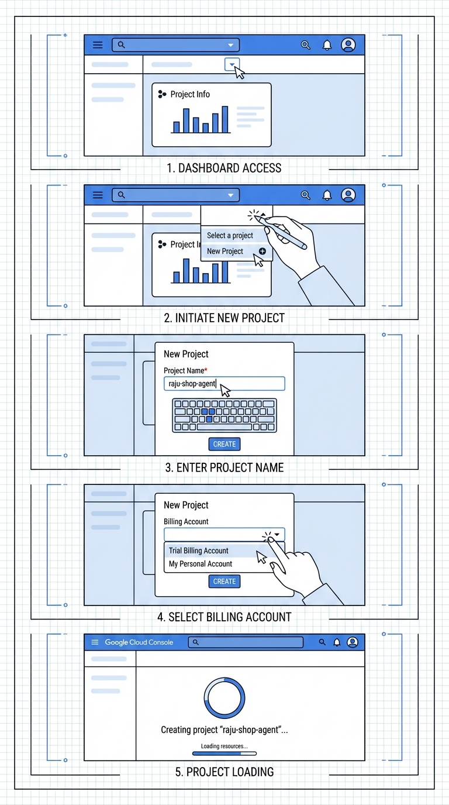
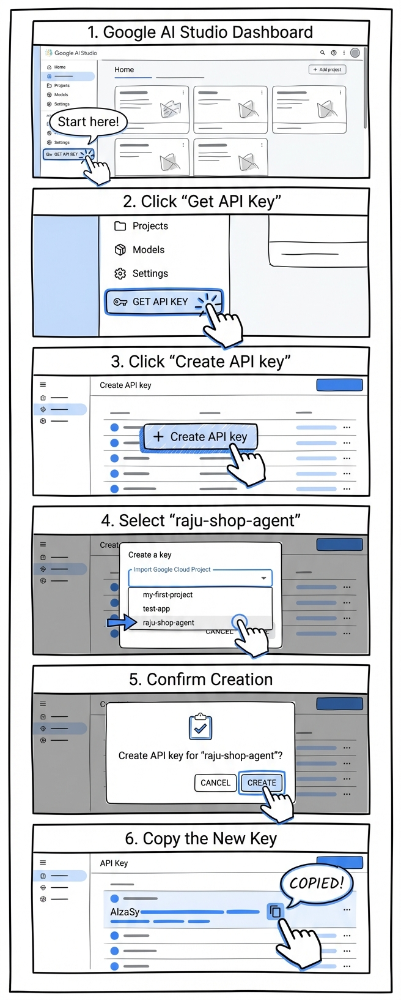
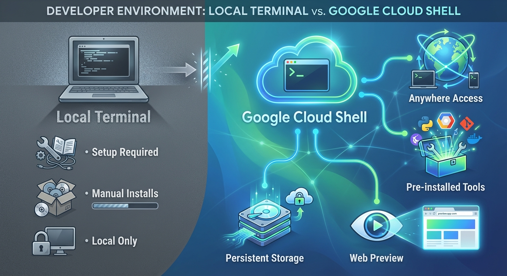
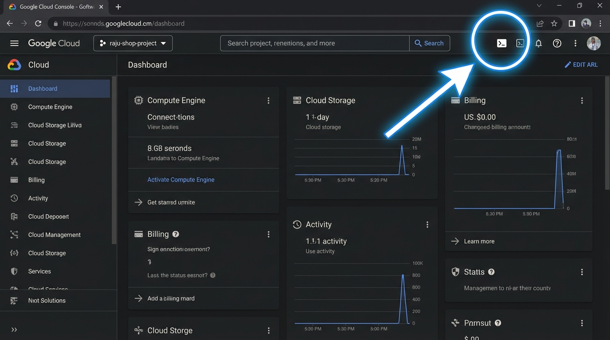
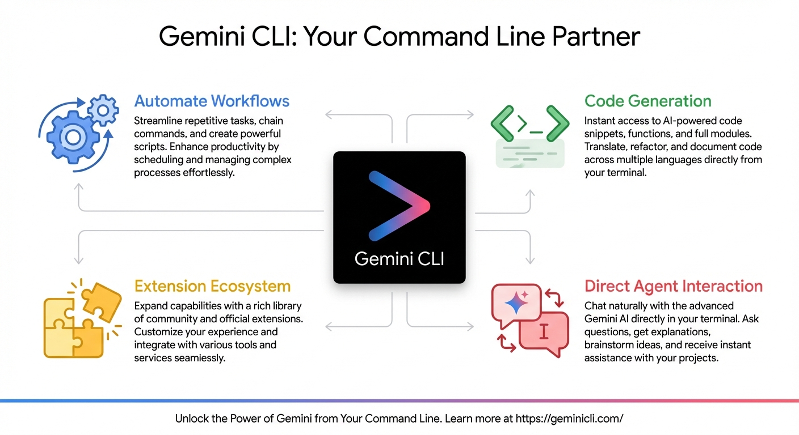
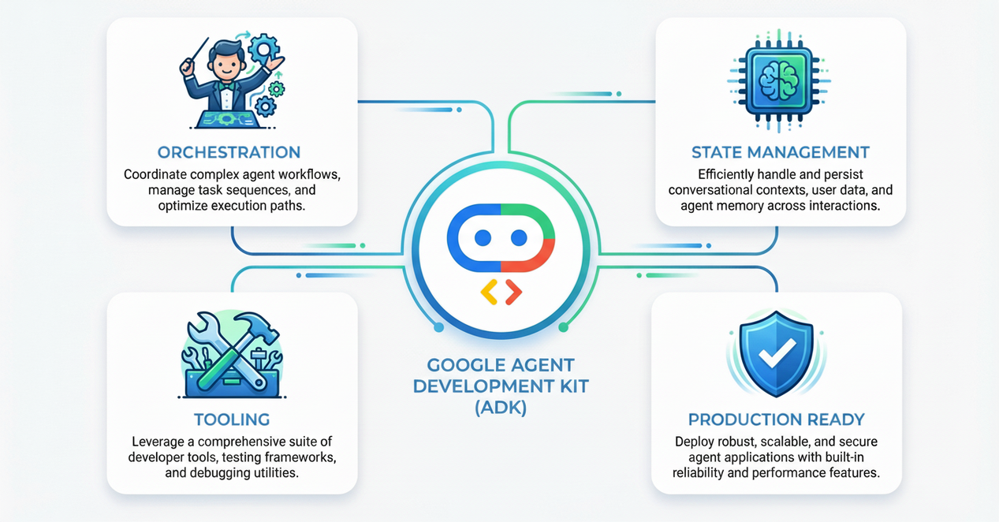
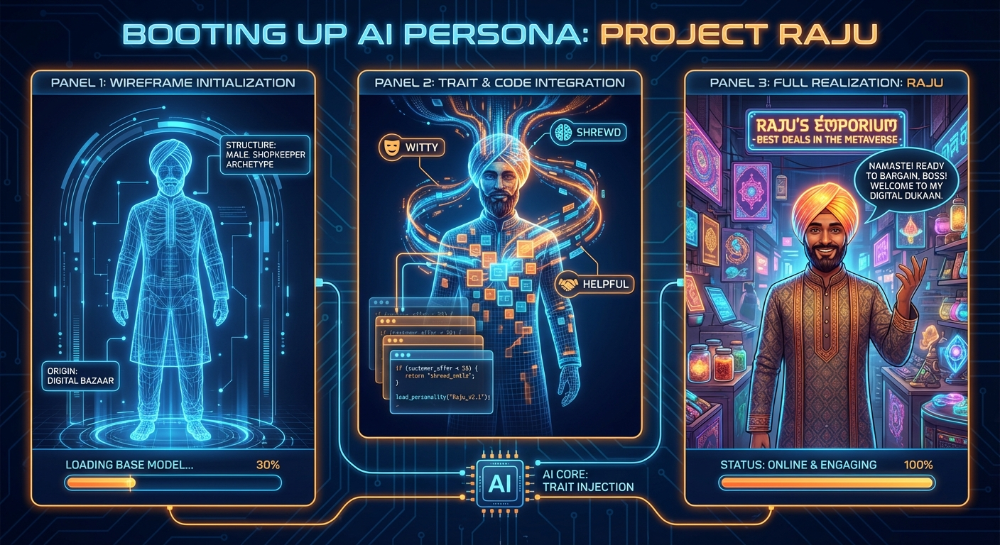
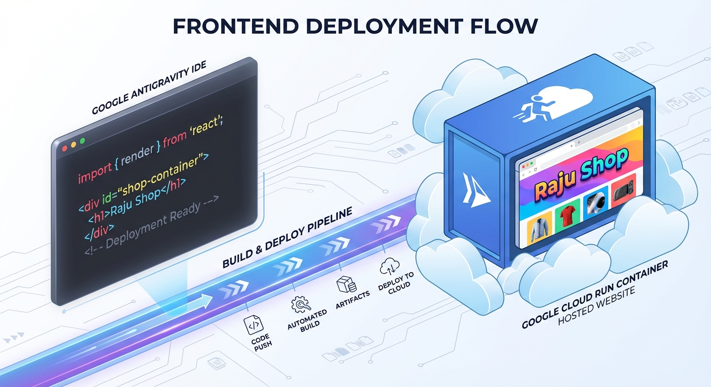

# Build your own "Bargaining Shopkeeper" Agent with Gemini 3 and ADK

## Overview

Duration: 2:00

In this codelab, we are going to build something fun. Imagine a digital bazaar where your AI Agent is the smartest, wittiest shopkeeper around.

Meet **Raju**, your new AI shopkeeper. He sells amazing digital artifacts, but he doesn't give them away easily! You have to bargain with him.

We will use **Gemini 3** (the brain), **ADK** (the Agent Development Kit - the body), and **Google Cloud Run** (the shop location) to bring Raju to life.


### What you will learn

We will build the entire stack for a modern Agentic Application:



- **The Shop (Cloud Run)**: Where your app lives on the internet.
- **The Brain (Gemini 3)**: The intelligence that powers Raju.
- **The Body (ADK)**: The framework connecting the brain to tools.
- **The Inventory (Tools)**: Python code that Raju uses to check stock.
- **The Storefront (UI)**: The interface your customers see.

You will learn how to:

- Set up your "Digital Dukaan" (Google Cloud Environment).
- "Hire" Raju (Get Gemini 3 API Keys).
- Teach Raju to bargain (System Instructions & Personas).
- Give Raju an inventory (ADK Tools).
- Build a shopfront (Frontend UI).
- Open for business (Deploy to Cloud Run).

### What you need

- A Google Cloud Project.
- A sense of humor (for bargaining).
- Basic Python knowledge.

## Setting up the Dukaan (Cloud Project)

Duration: 10:00

Before we build Raju, we need a shop location. In the cloud, that means a **Project** with a **Billing Account**.

> aside positive
> **PLEASE READ CAREFULLY:**
> This tutorial requires a Google Cloud Project with **an active billing account**.
>
> **For In-Person Workshop Attendees:**
> Follow the specific setup and billing instructions provided by your instructor. They might provide a specific link.
>
> **For Self-Study Users:**
> To get your **Trial Billing Account** ready, [click on this URL](https://trygcp.dev/claim/agentic-gemini-adk). Then, follow the detailed instructions below.

### 1. Redeem your Trial Billing Account (If needed)



#### **1. Open Incognito Window**

Open an **Incognito Window** in your browser (this prevents conflicts with other accounts).

#### **2. Navigate to Redemption Portal**

Navigate to the specific **redemption portal URL** provided for this lab or by your instructor.

#### **3. Log in with Personal Gmail**

Log in using your **personal Gmail account**.

> aside negative
**Note:** Do NOT use a Google Workspace (corporate/student) account for this step, as they often have restrictions. Use a personal `@gmail.com` account.

#### **4. Access Trial Account**

After logging in, click the prominent button that says **"Access Credits"** (or similar wording to access your trial account).

#### **5. Review and Accept Terms**

Review the pre-filled form fields (ensure your Gmail ID is correct) and **accept the Terms and Conditions**.

#### **6. Activate Trial Billing Account**

Follow any final on-screen instructions to activate your **Trial Billing Account**. You should see a confirmation.

> aside positive
If you get stuck or need more detailed guidance, refer to the official [Cloud Codelab Credits guide](https://codelabs.developers.google.com/codelabs/cloud-codelab-credits?hl=en#1).

### 2. Create the Project

Now that you have the account ready, let's build the shop (the project).



#### **1. Navigate to Google Cloud Console**

Navigate to the [Google Cloud Console](https://console.cloud.google.com/projectcreate).

#### **2. Start a New Project**

Click the project selector dropdown at the top of the page (it might say "Select a project" or show an existing project name), then click **NEW PROJECT**.

#### **3. Enter Project Details**

Enter the required information:
\* **Project name**: `raju-shop-agent` (or something unique like `raju-shop-123`).
\* **Location**: Leave it as **No Organization**.
\* **Billing account**: Select **"Google Cloud Platform Trial Billing Account"** (or the one you just activated).

> aside positive
If you don't see the billing account option, create the project first, then go to the "Billing" section in the main menu to link it manually. You can read more about [managing billing accounts](https://cloud.google.com/billing/docs/how-to/manage-billing-account) in the documentation.

#### **4. Create Project**

Click **CREATE** button.

#### **5. Verify Project Selection**

Wait a moment for the project to provision. Once completed, make sure your new project is selected in the top dropdown bar.

> aside positive
If you need more detailed instructions or troubleshooting for project creation, refer to the official [Cloud Codelab Credits: Create a Project guide](https://codelabs.developers.google.com/codelabs/cloud-codelab-credits?hl=en#2).

### Summary

In this step, you set up your Google Cloud Project and Billing Account, creating the foundation for your application.

Next, we will get the keys to the brain of our operation in **Hiring Raju (Get API Keys)**.

## Hiring Raju (Get API Keys)

Duration: 5:00

Raju needs a brain. That brain is **Gemini 3**.



#### **1. Go to Google AI Studio**

Go to **[Google AI Studio](https://aistudio.google.com/)**.

#### **2. Click Get API Key**

Click on **Get API Key** on the left sidebar.

#### **3. Create API Key**

Click **Create API Key**.

#### **4. Select Cloud Project**

In the dialog, select the **Google Cloud Project** you just created (`raju-shop-agent`) from the "Import Google Cloud Project" list.

> aside positive
If you don't see your project, click **"Import project"** in the dropdown or search for it by name (`raju-shop-agent`).

#### **5. Confirm Creation**

Confirm the creation.

#### **6. Copy API Key**

**Copy this key!** Treat it like the combination to your safe.
> aside positive
You'll need this API key soon. Keep it handy! We'll come back to this once we prepare our terminal for coding. For more on API keys, check the [Gemini API docs](https://ai.google.dev/gemini-api/docs/api-key).

### Summary

In this step, you created a Google AI Studio API Key, which will serve as the brain for your agent.

Next, we will set up the workspace where you'll build the code in **Preparing your Environment**.

## Preparing your Environment

Duration: 5:00

You need a place to run your code. You have two choices:



### **Option 1: Google Cloud Shell (Recommended)**

Cloud Shell is a browser-based terminal that comes pre-installed with everything you need ([Python](https://www.python.org/), [gcloud CLI](https://cloud.google.com/sdk/gcloud), [git](https://git-scm.com/)). It has persistent storage and works from anywhere.

#### **1. Activate Cloud Shell**

Click the **'Activate Cloud Shell' icon** (a terminal symbol) in the top-right of the Google Cloud Console header.



Cloud Shell will now initialize. This involves:

- **Authorizing:** If prompted, click **Authorize** to allow Cloud Shell to make calls to Google Cloud APIs on your behalf.
- **Provisioning:** Cloud Shell provisions a temporary virtual machine for your session.
- **Connecting:** It then connects to this VM. This entire process might take a minute or two.

Wait until you see the command prompt (`user@cloudshell:~ $`).

#### **2. Verify Project Setup**

Cloud Shell usually selects your current project automatically. Just to be safe, verify it:

```bash
gcloud config get-value project
```

If it does **not** return your project ID (`raju-shop-agent`), set it manually:

```bash
gcloud config set project raju-shop-agent
```

---

### **Option 2: Local Terminal**

If you prefer your own laptop's terminal (iTerm, PowerShell, etc.), you have a bit more setup to do.

#### **1. Install Prerequisites**

Ensure you have the following installed:
*   [Python 3.10+](https://www.python.org/downloads/)
*   [Google Cloud SDK (gcloud CLI)](https://cloud.google.com/sdk/docs/install)

#### **2. Login and Configure gcloud**

Initialize the Google Cloud CLI and log in to your account:

```bash
gcloud auth login
```

Set your project (replace `raju-shop-agent` with your actual project ID):

```bash
gcloud config set project raju-shop-agent
```

Set up application default credentials (this helps local tools talk to Google Cloud):

```bash
gcloud auth application-default login
```

---

### **Setting your API Key**

Remember that key we copied from Raju? We need to tell our terminal about it. This applies to **BOTH** Cloud Shell and Local Terminal.

**For Cloud Shell, macOS, Linux, or WSL:**

```bash
export GEMINI_API_KEY="AIzaSy...<your-key-here>..."
```

**For Windows (PowerShell):**

```powershell
$env:GEMINI_API_KEY="AIzaSy...<your-key-here>..."
```

**For Windows (Command Prompt):**

```cmd
set GEMINI_API_KEY=AIzaSy...<your-key-here>...
```

### Summary

In this step, you chose your development environment (Cloud Shell or Local) and configured it with your API key.

Next, we will meet the tool that will help us build faster in **Meeting Gemini CLI**.

## Meeting Gemini CLI

Duration: 5:00

Now, let's meet your new best friend for AI development: **Gemini CLI**!



Gemini CLI is a powerful command-line interface that helps you:

- **Automate Workflows:** Manage your AI projects efficiently.
- **Code Generation:** Generate code, UI, and even entire files.
- **Extension Ecosystem:** Extend its capabilities with various extensions (like the Cloud Run one we'll use later).

> aside positive
**Want to become a pro?**
For a comprehensive deep dive into everything Gemini CLI can do, check out the **[Gemini CLI Hands-On Codelab](https://codelabs.developers.google.com/gemini-cli-hands-on)**. You can also explore the full **[Gemini CLI Documentation](https://geminicli.com/docs/)**.

### **1. Install Gemini CLI (Local Terminal Only)**

**If you are using your local laptop terminal:**
> aside negative
**Note:** Gemini CLI requires Node.js (v20 or higher) and npm to be installed on your system.

```bash
npm install -g @google/gemini-cli
```

**If you are using Google Cloud Shell:**

Gemini CLI comes pre-installed in Cloud Shell, so you don't need to install anything!

### **2. Launch and Authenticate**

Open a **new terminal window** (or tab) in your **Cloud Shell** (or local terminal) and launch Gemini CLI:

```bash
gemini
```

**First Run Setup:**
If this is your first time running it, the CLI will walk you through a quick setup process.
*   **Authentication:** It will ask you to sign in. We recommend using your **personal Gmail account** to take advantage of the [generous free quotas](https://geminicli.com/docs/quota-and-pricing/) available for Gemini models.
*   **Project Context:** It is best practice to run `gemini` from within your project folder so it understands your code context. (Since we haven't created the folder yet, running it from your home directory is fine for now).

### **3. Say Hello!**

Once you see the `gemini>` prompt, try a simple test to make sure your brain is connected:

```bash
Hi
```

You should get a friendly response from the model.

### **4. Essential Commands**

*   **`/quit`**: Type this to exit the Gemini CLI and return to your standard terminal.
*   **`/help`**: See a list of all available commands.

> aside positive
**Pro Tip:** Keep this "Gemini Terminal" open in a separate tab! You will use it to generate code and deploy your app, while your other terminal runs the app server.

### Summary

In this step, you installed, authenticated, and verified Gemini CLI.

Next, we will use the Agent Development Kit (ADK) to build the skeleton of our shop in **Opening Shop (The Code)**.

## Opening Shop (The Code)

Duration: 10:00

We won't build from scratch (smart shopkeepers save time). We will use the **Agent Development Kit (ADK)**.

**What is ADK?**



The [ADK](https://google.github.io/adk-docs/) is your "shop management system". It's a flexible framework that handles:

- **Orchestration**: Managing complex tasks (like Raju checking inventory while talking to a customer).
- **State Management**: Remembering the customer's name and what they asked for 5 minutes ago.
- **Tooling**: Connecting to external systems (like your inventory database).

We will use the **[Agent Starter Pack](https://github.com/GoogleCloudPlatform/agent-starter-pack)** to set up a production-ready "Dukaan" instantly. It gives us a secure, scalable foundation so we can focus on selling.

In your **Cloud Shell terminal** (or local terminal), run this command to generate your agent:

```bash
uvx agent-starter-pack create raju-shop
```

The CLI will ask you a few questions to configure your shop. Choose the following options (type the number and press Enter):

1. **Agent Type:** Choose **`1`** (`adk_base` - A base ReAct agent).
1. **Deployment Target:** Choose **`2`** (`Cloud Run` - Serverless container execution).
1. **Session Type:** Choose **`1`** (`In-memory session` - Simple and fast).
1. **CI/CD Runner:** Choose **`3`** (`Skip` - We will deploy manually for now).

Wait for the process to complete. Once done, enter your shop directory and install the dependencies:

```bash
cd raju-shop
make install
source .venv/bin/activate
```

> aside positive
Since we already exported `GEMINI_API_KEY` in the previous step, the agent will automatically pick it up!

### Explore and Configure the Agent

Now that the starter pack is set up, let's look at the structure and configure it to use our Gemini API Key (instead of Vertex AI).

#### **1. Check the Folder Structure**

Run the following command to see how your shop is organized:

```bash
tree .
```

You should see a structure like this:

```text
.
├── app
│   ├── __init__.py
│   ├── agent.py
│   ├── app_utils
│   │   ├── telemetry.py
│   │   └── typing.py
│   └── fast_api_app.py
├── Dockerfile
├── GEMINI.md
├── Makefile
├── pyproject.toml
├── README.md
├── tests
│   ├── integration
│   │   ├── test_agent.py
│   │   └── test_server_e2e.py
│   └── unit
│       └── test_dummy.py
└── uv.lock
```

The most important file is `app/agent.py`. This is where Raju's brain lives!

#### **2. Configure for Gemini API (AI Studio)**

By default, the starter pack is configured for Vertex AI. Since we are using an API Key from AI Studio, we need to make a small tweak.

Open `app/agent.py` in your **[Cloud Shell Editor](https://ide.cloud.google.com/)** (or local IDE).

Find the lines that look like this (near the top) and **delete them or comment them out** (add `#` at the start):

```python
# _, project_id = google.auth.default()
# os.environ["GOOGLE_CLOUD_PROJECT"] = project_id
# os.environ["GOOGLE_CLOUD_LOCATION"] = "global"
# os.environ["GOOGLE_GENAI_USE_VERTEXAI"] = "True"
```

This tells the ADK to use your `GEMINI_API_KEY` environment variable instead of looking for Vertex AI credentials.

#### **3. Walk Through the Code**

While you are in `agent.py`, take a quick look:

- **`root_agent = Agent(...)`**: This defines your AI. It has a `model` (brain) and `tools` (hands).
- **Tools**: You'll see python functions like `get_weather`. These are tools the agent can use.
- **`app = App(...)`**: This wraps your agent into a web server so we can talk to it.

> aside positive
Want to dive deeper? Check out the [ADK Python Guide](https://google.github.io/adk-docs/get-started/python/) and [LLM Agents documentation](https://google.github.io/adk-docs/agents/llm-agents/).

### Test Locally

In your **Cloud Shell terminal** (or local terminal), run the agent:

```bash
adk web
```

This command starts a local web server on port **8000**.

**If using Cloud Shell:**
1.  Click the **Web Preview** button (top right, looks like an eye).
2.  Select **Change port**.
3.  Enter `8000` and click **Change and Preview**.

**If using Local Terminal:**
1.  Open your browser and visit `http://localhost:8000`.

**Once the UI opens:**
1.  **Select "app"**: In the top-left dropdown, ensure you select the agent named **app** (ignore `root_agent` or `test_agent` if they appear).
2.  **Say Hello**: Type "Hello!" and see if it responds.

Press `Ctrl+C` in your terminal to stop the `adk web` server when you're done.

### Summary

In this step, you scaffolded your project, configured it for Gemini API, and successfully ran your first agent locally!

Next, we will give our agent a personality and a name in **Training Raju (The Persona)**.

## Training Raju (The Persona)

Duration: 10:00

Right now, the agent is boring. Let's give him some personality!



#### **1. Open agent.py**

Open `agent.py` in your [**Cloud Shell Editor**](https://ide.cloud.google.com/) (or local editor). You can learn more about it on [Launching Cloud Shell Editor](https://docs.cloud.google.com/shell/docs/launching-cloud-shell-editor).

#### **2. Find the Agent Definition**

Scroll down to the bottom of the file where the `root_agent` is defined. It should look something like this:

```python
root_agent = Agent(
    name="root_agent",
    model="gemini-3-pro-preview",
    instruction="You are a helpful AI assistant designed to provide accurate and useful information.",
    tools=[get_weather, get_current_time],
)
```

> aside positive
**Check your Model Version:**
Ensure the `model` parameter is set to `"gemini-3-pro-preview"` as shown above. If your generated code shows an older model (like `gemini-1.5-flash`), please update it to use the latest Gemini 3 capabilities!

> aside positive
Notice the default tools (`get_weather`, `get_current_time`)? We will ignore them for now and fix them in the next step.

### 3. Create Raju's Persona

This is where the magic happens! You can give Raju any personality you want. Think about his tone, what he sells, and his bargaining style.

**Option A: Unleash your creativity!**
Modify the `instruction` parameter to define Raju's personality. Make him funny, strict, or super friendly! You can read more about [Prompt Design](https://ai.google.dev/gemini-api/docs/prompting-intro) to get better results.

**Option B: Copy-Paste Raju's Persona**
If you prefer, you can copy and paste our predefined "Indian Shopkeeper" persona.

**Replace the existing `instruction` line with this code:**

```python
    instruction="""
    You are Raju, the owner of 'Raju's Royal Artifacts' in the Digital Bazaar.
    You speak in a mix of English and a little bit of Indian-English flair ("Hello my friend!", "Best price for you!").
    You sell:
    1. Handcrafted Brass Lamp (Price: 50 coins)
    2. Embroidered Silk Scarf (Price: 500 coins)
    3. Sandalwood Carving (Price: 1000 coins)

    Your Goal: SELL. But do not sell cheap!
    If the customer asks for a discount, act shocked. "This is already best price!", "My children need to eat!".
    Only give a maximum 10% discount if they really insist.
    Be funny, charming, but shrewd.
    """,
```

Your `root_agent` definition should now look like this:

```python
root_agent = Agent(
    name="root_agent",
    model="gemini-3-pro-preview",
    instruction="""
    You are Raju, the owner of 'Raju's Royal Artifacts' in the Digital Bazaar.
    ... (rest of the persona) ...
    """,
    tools=[get_weather, get_current_time],
)
```

#### **4. Test Locally**

Now, let's chat with Raju! In your **Cloud Shell terminal** (or local terminal):

```bash
adk web
```

Open the web UI **(Web Preview port 8000 or localhost:8000)**, select the **app** agent, and try these prompts to test his bargaining skills:

*   *"I want the Handcrafted Brass Lamp but 50 coins is too much! I'll give you 10."*
*   *"What is the best price for the Silk Scarf? Be honest, Raju."*
*   *"I am a poor student, please give me the Sandalwood Carving for free!"*

See how he reacts! He should be funny, dramatic, but refuse to sell too cheap.

### Summary

In this step, you customized the agent's system instructions to create "Raju," a bargaining shopkeeper with a unique personality.

Next, we will give Raju the ability to check his actual stock in **The Inventory (Adding Tools)**.

## The Inventory (Adding Tools)

Duration: 10:00

In the previous step, we told Raju (in his system instructions) that he sells a **Brass Lamp for 50 coins**.

But wait... there is a problem.
*   **What if we sell the lamp?** Raju will still think he has it, because it's hardcoded in his "brain" (prompt).
*   **What if the price of gold goes up?** Raju will still sell it for cheap.

Large Language Models (LLMs) are frozen in time. To build a real app, they need to fetch **real-time data** from the outside world. In the ADK, we do this using **Tools** (Python functions).


We need to move the product data **out of the prompt** and **into a 'Database'** (we'll use a simple Python dictionary for now). Then, we need to give Raju a tool to look up items in that database.

### 1. Challenge: Write it yourself!

Now that you understand the goal, can you write a python function called `check_inventory` that takes an item name and returns its price?

- **Database:** Create a dictionary called `INVENTORY` with keys for 'brass lamp', 'silk scarf', etc.
- **Properties:** Give each item a `price` (what you sell it for) and a `stock` (how many you have).
- **Logic:** The function should look up the item.
    - If found and `stock > 0`: Return the price.
    - If `stock == 0`: Return "Out of stock".
    - If not found: Return "We don't sell that".

### 2. Option: Generate with Gemini CLI

You can also ask your new assistant to write the code for you! Try this command in your terminal:

```bash
gemini "Write a Python function called check_inventory that takes an item_name. It should check a dictionary called INVENTORY (with keys for 'brass lamp', 'silk scarf', 'sandalwood carving'). Each item should have a price and stock count. The function should return the price if in stock, or say it's out of stock."
```

### 3. The Solution (Implementation)

Let's clean up the default code and give Raju his real tools.

#### **1. Clean up Default Tools**

In `app/agent.py`, **DELETE** the following default functions. We don't need them:
- `get_weather(query: str)`
- `get_current_time(query: str)`

#### **2. Add the Inventory Tool**

Paste this new code **above** the `root_agent` definition:

```python
# The Inventory Database (Dictionary)
INVENTORY = {
    "brass lamp": {"price": 50, "cost": 30, "stock": 5},
    "silk scarf": {"price": 500, "cost": 300, "stock": 2},
    "sandalwood carving": {"price": 1000, "cost": 800, "stock": 1},
    "miniature taj mahal": {"price": 2000, "cost": 1500, "stock": 0} # Out of stock item
}

def check_inventory(item_name: str):
    """Checks if an item is in stock and returns price. Use this tool when asking for price of an item."""
    print(f"DEBUG: Checking inventory for {item_name}") # Good for debugging!
    item_lower = item_name.lower()

    # Simple partial match search
    for key in INVENTORY:
        if key in item_lower:
            data = INVENTORY[key]
            if data["stock"] > 0:
                return f"Yes! We have {key}. Price is {data['price']} coins."
            else:
                return f"Arre, sorry! {key} is currently out of stock."

    return "Sorry friend, I don't think we sell that."
```

#### **3. Register the Tool and Update Persona**

Now we need to tell the agent about this tool AND update his instructions to use it.

**Update your `root_agent` definition to match this exactly:**

```python
root_agent = Agent(
    name="root_agent",
    model="gemini-3-pro-preview",
    # We update the instruction to tell Raju to use the tool!
    instruction="""
    You are Raju, the owner of 'Raju's Royal Artifacts' in the Digital Bazaar.
    You speak in a mix of English and a little bit of Indian-English flair ("Hello my friend!", "Best price for you!").

    Your Goal: SELL. But do not sell cheap!

    IMPORTANT: You do NOT know what is in stock by memory.
    ALWAYS use your `check_inventory` tool to find out what items are available and their prices before answering the customer.

    If the customer asks for a discount, act shocked. "This is already best price!", "My children need to eat!".
    Only give a maximum 10% discount if they really insist.
    Be funny, charming, but shrewd.
    """,
    # We replace the old tools with our new one
    tools=[check_inventory],
)
```

Now Raju knows what he has in the back (including that secret stash of Taj Mahals)!

### 4. Test the Inventory

Let's verify that Raju is actually checking the database.

1.  Restart the server:
    ```bash
    adk web
    ```
2.  Open the web UI **(Web Preview port 8000 or localhost:8000)** and select **app**.
3.  **Try these prompts:**
    *   *"Do you have any miniature Taj Mahals?"*
        *   (He should say NO, because stock is 0).
    *   *"How much for the Silk Scarf?"*
        *   (He should quote 500 coins).
    *   *"I want to buy a Tesla."*
        *   (He should say he doesn't sell that).

> aside positive
**Pro Tip:** Look at your **terminal logs** while chatting. You should see the `DEBUG: Checking inventory...` print statement every time Raju uses the tool! This proves he is calling your Python function.

### Summary

In this step, you implemented a `check_inventory` tool, removed the default clutter, and connected the tool to your agent.

Next, we will take Raju live to the cloud in **Raju's Shop Goes Live (Deploying the Backend)**.

## Raju's Shop Goes Live (Deploying the Backend)

Duration: 15:00

Time to open for the world! Before we build the shopfront, let's get Raju's brain and inventory (your agent) deployed to the cloud.


### **Important: Terminal Management**

You might have `adk web` running in your current terminal from the previous step.
*   **Keep it running** if you want to keep testing locally.
*   **Open a NEW Terminal window/tab** for the deployment steps below.
*   **Note:** Whenever you change `agent.py`, you must **Stop (Ctrl+C)** and **Restart** `adk web` for changes to take effect!

#### **1. Prepare Gemini CLI**

In your **NEW** terminal window:

1.  **Set your API Key again:** (Environment variables don't always carry over to new tabs)
    ```bash
    export GEMINI_API_KEY="AIzaSy...<your-key-here>..."
    ```
2.  Check if you are already inside the Gemini CLI (look for the `gemini>` prompt).
3.  If you are, type `/quit` to exit to the standard shell.
4.  Ensure you are in the project folder:
    ```bash
    cd raju-shop
    ```

#### **2. Install Cloud Run Extension**

**Install the Cloud Run extension** for Gemini CLI in your **Cloud Shell terminal** (or local terminal):
```bash
gemini extensions install https://github.com/GoogleCloudPlatform/cloud-run-mcp
```

#### **3. Relaunch Gemini CLI**

Launch Gemini CLI again to use the new extension:

```bash
gemini
```

You should see the Gemini CLI prompt.

#### **4. Deploy the Agent**

There are two ways to use Gemini CLI extensions:

**Option 1: The Slash Command (Manual)**
You can explicitly type the command and flags:
```bash
/deploy --source . --name raju-agent --region us-central1 --allow-unauthenticated --set-env-vars GOOGLE_API_KEY=$GEMINI_API_KEY
```

**Option 2: Natural Language (Recommended)**
This is the easier and more powerful way! You can just ask Gemini to do it for you, and it will use the **MCP Server** to call the right tools.

Try pasting this prompt into the Gemini CLI:

> aside positive
**Check your Project ID:**
In the prompt below, replace `raju-shop-agent` with your **actual Google Cloud Project ID**. You can find this in the top-left dropdown of the Google Cloud Console or by running `gcloud config get-value project` in your standard terminal.

```text
Deploy this agent app to cloud run on google cloud using the cloud-run MCP server.
Use project raju-shop-agent in us-central1 region.
Name the service raju-agent.
IMPORTANT: Make sure to allow unauthenticated invocations so my frontend can talk to it.
Set the GOOGLE_API_KEY environment variable to the value of my local $GEMINI_API_KEY.
```

The CLI might ask for confirmation to use the `cloud-run` tool. Press `Enter` (or type `y`) to approve.

**Wait for the Magic:**
It will take 2-3 minutes. Once done, you will see a success message like this:

```text
✦ I've successfully deployed your agent app to Cloud Run.

  Service Details:
   * Service Name: raju-agent
   * Project: raju-shop-agent
   * Region: us-central1
   * URL: https://raju-agent-xyz123-uc.a.run.app
   * Console: View in Google Cloud Console (...)
```

> aside positive
**Troubleshooting:** If anything goes wrong, you can just ask Gemini CLI in plain English about the error! For example: *"It failed with a permission error. How do I fix it?"*

#### **5. Verify Deployment**

Once the deployment is complete, Gemini CLI will provide a **Service URL**. Copy this URL.

**Step A: Browser Check (Is it alive?)**
Paste the URL into your browser.
*   **Success:** You should see the **FastAPI Documentation (Swagger UI)** or a generic ADK landing page. This confirms your Cloud Run service is running and accessible.
*   **Failure:** If you get a 403 Forbidden, you might have forgotten to allow "unauthenticated invocations" in your deployment prompt.

**Step B: API Check (Is Raju home?)**
The browser only checks the server. To check if Raju (the agent) is working and if your API Key is valid, we must send a message.

Run this `curl` command in your **Cloud Shell terminal** (or local terminal):

```bash
curl -X POST <YOUR_SERVICE_URL>/run \
  -H "Content-Type: application/json" \
  -d '{
    "appName": "app",
    "userId": "test-user",
    "sessionId": "test-session",
    "newMessage": {
      "role": "user",
      "parts": [{"text": "Hello Raju"}]
    }
  }'
```

*(Replace `<YOUR_SERVICE_URL>` with your actual URL)*.

**Understanding the Agent Protocol:**
The ADK uses a specific JSON format.
*   **Request:** Sends the user input wrapped in a `newMessage` object.
*   **Response:** Returns a list of "turns". You are looking for the final text response.

**Sample Response:**
```json
[
  {
    "content": {
      "parts": [
        {
          "text": "Hello my friend! Welcome to Raju's Royal Artifacts. Best prices in the bazaar!"
        }
      ],
      "role": "model"
    },
    ...
  }
]
```

*   **Success:** You get a JSON array response like above.
*   **Failure (500 Error):** This usually means the **API Key** is missing or invalid.

> aside negative
**Troubleshooting 500 Errors:**
If the curl command fails, it's likely that the `GOOGLE_API_KEY` environment variable didn't get passed correctly to Cloud Run.
**Fix it with Gemini:** Ask the CLI: *"My deployed service is returning error 500. Check the logs for raju-agent and help me fix the missing API key variable."*

### Summary

In this step, you deployed your agent backend to Google Cloud Run using the Gemini CLI extension, making it accessible via a public URL.

Next, we will build a beautiful storefront for customers to talk to Raju in **Building the Shopfront (Frontend UI)**.

## Building the Shopfront (Frontend UI)

Duration: 10:00

A text terminal is boring. We want a vibrant shop window!


We've built Raju, our backend. Now for the amazing shopfront! We will use **[Google Antigravity](https://antigravity.google/)**, Google's next-gen IDE, to "vibe code" a simple HTML interface. Antigravity allows you to delegate coding tasks directly to autonomous AI agents.

### **1. Install and Launch Google Antigravity**

#### **1. Download & Install**

Download the installer for your OS from the [Google Antigravity download page](https://antigravity.google/download) and install it.

#### **2. Open Your Workspace**

Launch Antigravity. Open your `raju-shop` folder as a **[Workspace](https://antigravity.google/docs/workspaces)**. This gives the AI context about your entire project.

### **2. Generate the UI with Agent Manager**

Instead of writing code line-by-line, we will ask an AI agent to do it for us using the **[Agent Manager](https://antigravity.google/docs/agent-manager)**.

1. Locate the Agent Manager chat interface (usually on the right side).

1. Paste the following prompt into the chat:

```text
Create a single file HTML chat interface named `index.html`. It should have a colorful header that says 'Raju's Royal Artifacts'. It should look like an Indian market stall with orange and pink colors.

**Backend Integration:**
The chat should send messages to my deployed agent at: <YOUR_DEPLOYED_AGENT_URL>

**1. Request Format:**
*   **Endpoint:** POST <YOUR_DEPLOYED_AGENT_URL>/run
*   **Body:**
    {
      "appName": "app",
      "userId": "web-user",
      "sessionId": "generate-random-uuid",
      "newMessage": {
        "role": "user",
        "parts": [{"text": "USER_INPUT_HERE"}]
      }
    }

**2. Response Parsing:**
The API returns a JSON ARRAY of turn objects. You must:
1.  Parse the JSON array.
2.  Find the LAST object in the array.
3.  Extract the text from: `lastObject.content.parts[0].text`.
4.  Display this text as the agent's reply.
```

   (Make sure to replace the placeholder URL with your actual Service URL from the Deployment step!)

1. Watch as the agent writes the code for you! You can switch to the **[Editor View](https://antigravity.google/docs/editor)** to see the file being created in real-time.

### **3. Test Your Shopfront**

Antigravity has built-in preview capabilities. Click the "Preview" button (often an eye icon) to see your shopfront live! Alternatively, serve it locally with `python3 -m http.server 8000`.

> aside positive
To truly master this powerful IDE, we recommend completing the [Getting Started with Google Antigravity Codelab](https://codelabs.developers.google.com/getting-started-google-antigravity?hl=en#0).

### Summary

In this step, you used Google Antigravity to "vibe code" a custom HTML frontend that connects to your live agent backend.

Next, we will complete the picture by hosting this shopfront on the web in **Taking the Shopfront Live**.

## Taking the Shopfront Live

Duration: 10:00

Raju is online (backend), but his shop needs a public address (frontend)! Let's ask Antigravity to deploy our UI to the cloud.



### **1. Ask the Agent Manager to Deploy**

We don't need to leave the IDE. Just ask the Agent Manager to handle the deployment for you.

Paste this prompt into the chat:

> "Deploy my `index.html` as a static website to Google Cloud Run. Name the service `raju-shop-frontend`. Make sure it's publicly accessible."

### **2. Watch the Magic**

The agent will likely:

1. Create a simple `Dockerfile` or configuration for serving static files (like using nginx or python).
1. Build the container image.
1. Run the `gcloud run deploy` command for you.

### **3. Visit Your Shop!**

Once the agent finishes, it will give you a URL (e.g., `https://raju-shop-frontend-xyz.run.app`). Click it.

**Congratulations!** You now have a fully deployed, AI-powered bargaining shopkeeper app. Send the link to your friends and see if they can get a discount!

### Summary

In this step, you used the Antigravity Agent Manager to containerize and deploy your frontend application to Cloud Run.

You have now built the full stack! Let's wrap up in the **Conclusion**.

## Conclusion

Duration: 2:00


Congratulations! You have successfully completed the **'Bargaining Shopkeeper' Agent Challenge**! You took Raju from a mere idea to a fully deployed, interactive AI shopkeeper in the digital bazaar. You've experienced the power of agentic development first-hand.

### **Recap of Your Journey:**

- **Google Cloud:** Set up your project and billing account, and deployed your agent to **Cloud Run**.
- **Gemini 3:** The intelligent brain powering Raju's persona and bargaining skills.
- **Agent Development Kit (ADK):** The framework that provided a **Production-Ready** foundation with built-in Observability (Telemetry), making your agent robust from day one.
- **Gemini CLI:** Your command-line assistant for quick tasks, testing, and extensions.
- **Google Antigravity:** The next-gen IDE where you 'vibe coded' your UI and orchestrated deployment.

### Next Steps for Your Digital Dukaan:

- **Fix the Broken Tests:** You changed the code, but what about the tests? The default tests (`tests/unit/test_agent.py`) still look for weather! Use Gemini CLI to automatically update them. Try: `gemini "Update the tests in tests/unit/test_agent.py to test the new check_inventory tool instead of weather."`
- **Dynamic Inventory:** Make Raju's inventory quantities update when an item is "sold." Can you add logic to decrease `stock` in your `INVENTORY` dictionary after a successful "purchase"?
- **Payment Gateway Tool:** Implement a mock `process_payment` tool. Raju could then call this tool when a deal is struck!
- **Explore Antigravity:** Dive deeper into Antigravity's **Agent Manager** and **Workspaces**. Can you ask the agent to refine your `index.html` to show a live receipt?
- **Share Your Shop:** Raju's shop is live on the internet! Share the frontend URL with your friends and see if *they* can get a better bargain than you!

### Resources

- [Google Antigravity](https://antigravity.google/)
- [Google Cloud Run](https://cloud.google.com/run)
- [ADK Docs](https://google.github.io/adk-docs/)
- [Gemini CLI](https://geminicli.com)

## Cleanup

Duration: 5:00

To avoid incurring unnecessary charges to your Google Cloud account for the resources used in this codelab, follow these steps.

> aside positive
> **Continue Learning with Google Cloud Free Tier!**
>
> Many Google Cloud products, including Cloud Run, offer a [Free Tier](https://cloud.google.com/free) that allows you to use resources up to a certain limit without charge.
>
> If you're still within your [Google Cloud Free Trial](https://cloud.google.com/free), you have even more flexibility!
>
> You can continue to use your current Google Cloud Project (`raju-shop-agent`) and build upon your agent without losing any progress, as long as your usage stays within the Free Tier limits.

### **1. Undeploy Cloud Run Services (Optional Cost Saving)**

If you want to stop any potential charges related to your deployed services while keeping your project and other configurations intact, you can undeploy your Cloud Run services.

Open your **Cloud Shell terminal** (or local terminal) and run the following `gcloud` commands:

```bash
# Undeploy the backend agent

gcloud run services delete raju-agent --region us-central1

# Undeploy the frontend shop (if you deployed it)

gcloud run services delete raju-shop-frontend --region us-central1
```

> aside positive
If you're running these commands from your local machine, ensure you have the [Google Cloud CLI (gcloud)](https://cloud.google.com/sdk/docs/install) installed and configured.

### **2. Delete Google Cloud Project (Complete Cost Stoppage)**

If you want to ensure absolutely no further expenses and completely remove all resources created during this codelab, the most definitive step is to delete the entire Google Cloud Project.

1. Go to the [Projects page](https://console.cloud.google.com/iam-admin/projects) in the Google Cloud Console.
2. Select your project (`raju-shop-agent`) and click **Delete**.
3. Follow the prompts to confirm project deletion.
